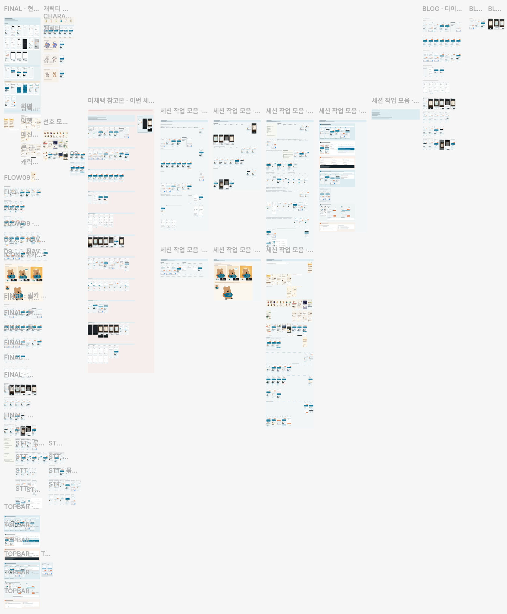
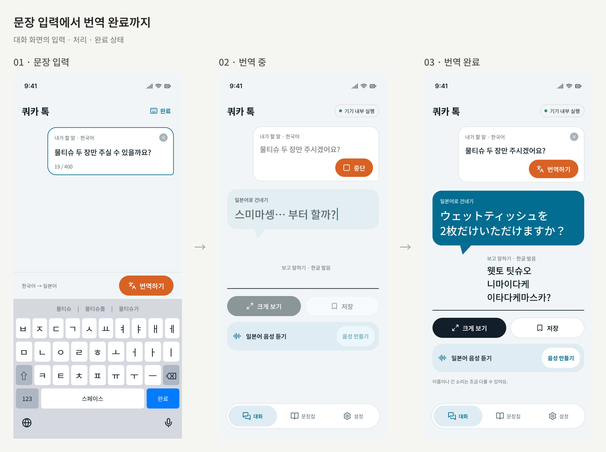
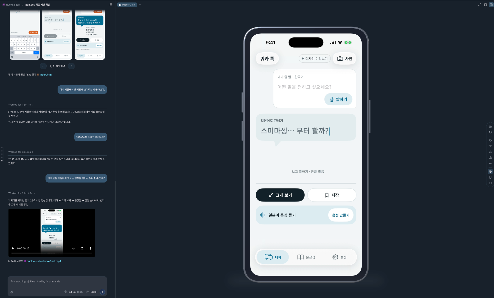
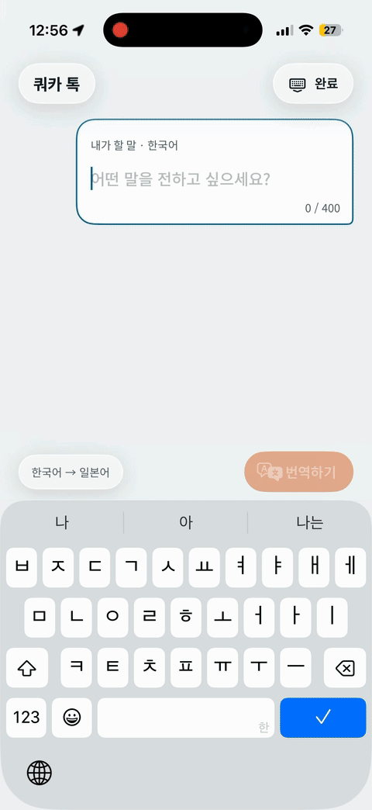
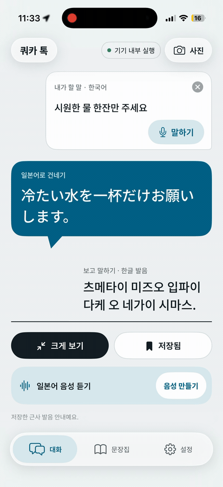
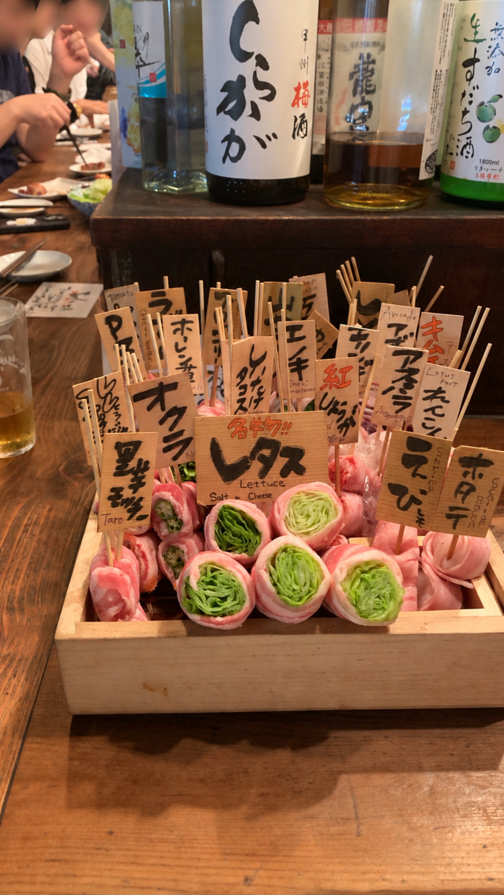
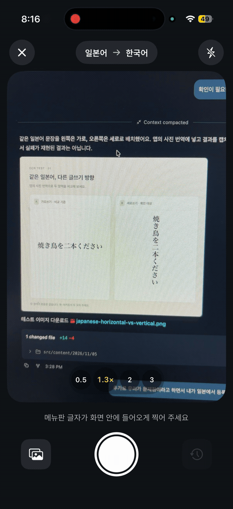
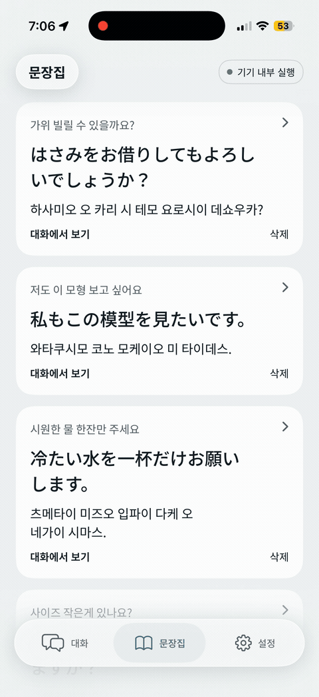
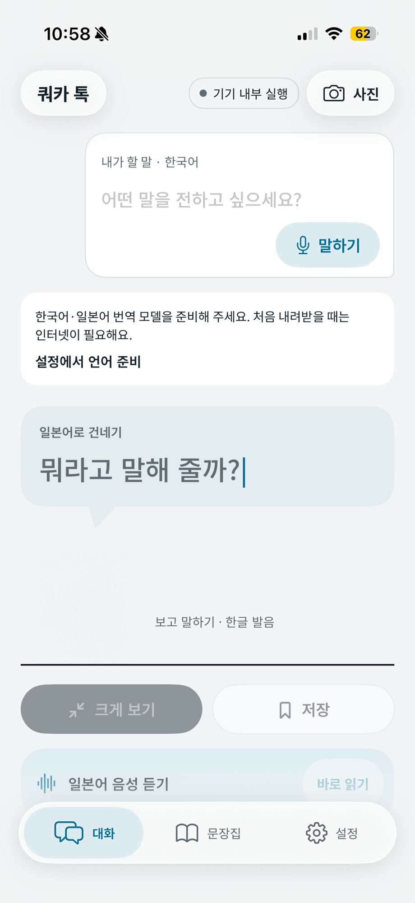

오랜만에 AI의 도움없이 글을 써보는 것 같다.
물론 이 블로그에서는 되도록이면 모두 내가 작성한 글로 채우는게 목표이지만 AI를 쓸수록 느끼는게, '이 AI가 나보다 나은 결과물을 생성해주지 않을까?' 하는 막연한 기대감 또는 두려움때문이었던 것 같다.

이 글에서는 AI에 대한 기대를 모두 내려놓고, 온전히 내 생각을 나의 말투와 글투로 전달해보려고 한다.

# 계기

시작은 막연히 여행일정이 잡힌 뒤였다.  
결혼 기념 당일을 소소하게 보내고, 아내의 시간적 여유가 생기는 10~11월 쯔음 해외여행을 계획했다.  
올 5월에 기타큐슈를 다녀온 뒤라, 그 여행지가 또 일본이 될 것이란걸, 당시에는 전혀 예상하지 못했다.

상하이, 푸꾸옥 등 여러 나라의 도시를 찾아보다가 비용이나, 시간을 고려했을 때 다시 선택지에 오른건 일본이었다.
그렇게 11월 1일부터 4일간 도쿄여행을 계획하게 되었다.

사실 여행의 계획을 대부분 아내가 담당해준다. 불만섞인 말투로 '좀 찾아봐'라고 하지만, 내가 찾은 결과물은 항상 마음에 들지 않는지, 어이없다는 듯 웃으며 돌아선다.
찾아준 아내에게 고마워서 비용을 조금 더 지불하거나, 아내를 위한 선물을 여행 중에 사주곤 했다.

즉, 시간이 남았다. 머릿속에 생각할 여유가 생겼던 것이다. 평소 시간을 의미있게 보내고 싶다고 생각하면서 자연스럽게 유튜브를 킨다. 쇼츠에 빠져서 한 시간을 훌-쩍 텅빈 시간을 보내고 난 뒤, 자책하며 돌아서곤 했다. (ㅜㅜ)

하지만 그 날은 조금 달랐다. 알고리즘이 토스의 [AI Voice에 대한 영상](https://youtu.be/j41oq_xbTgs?si=GcZZAQBkDcB4RFSN)을 띄워줬다.

영상을 보며, 머릿 속에 한 가지 생각이 스쳐갔다.

> 이번에도 번역기를 만들어볼까?

---

 

나는 2년 전 일본을 갈 때도 AI를 이용해서 번역기를 만들었다.
당시의 글은 [여기](https://geuni620.github.io/blog/2024/10/16/quokka-talk/)서 확인할 수 있다.

궁금했다. 사람들이 새로운 모델이 나오면 벤치마크라 부르며 이전 모델로 생성한 결과물과 비교해보곤 한다.
나에게도 벤치마크라 할 데이터 또는 결과물이 있을까 싶었는데, 이번 기회에 적절히 비교해볼 수 있겠다는 생각이 들었다.
물론 텀은 좀 길다. 2년, 길다면 길고, 짧다면 짧을 것이다. 작년 7월 클로드코드가 나온 뒤 1년 남짓한 시간동안 변화에 적응하기 힘들 정도로 많은 것들이 변한 걸 보면 2년은 엄청 길다는 생각도 든다. 많은 것들이 별할 수 있는 충분한 시간이다.

그렇게 이번에도 번역 앱을 만들어보기로 결심했다. 남은 기간은 미루고 미루다 정신차려보니 일주일 남았다.

 

# AI Native

> 'AI Native' ... 별로 좋아하는 단어는 아니다. 요즘은 AI를 이용해서 뭔가를 만들면 'AI Native하게 만들었어요.'라며 홍보하곤 한다. 단어의 가치가 떨어진 느낌이다. 하지만 적절한 단어가 생각나지 않아서 AI Native를 쓰게 되었다.

## 기획

나에겐 습관이 하나 있다. 관심있는 주제의 글이나 오픈소스 프로젝트, 기능 등을 [포켓처럼 담아놓는다.](https://www.geuni.me/blog/2026/06/30/tabular-nums?showShort=true)
오픈소스 프로젝트라면 Github에서 스타를 누르고, 트위터에서 봤다면 북마크를 해둔다. 글이라면 스크랩을 해두는 편이다.

이번에는 [VoiceStudio](https://github.com/debpalash/VoiceStudio)가 떠올랐다. 일레븐랩스의 보이스모델을 처음 보고, 대안을 오픈소스에서 찾다가 우연히 발견하게 되었다. <small>글에서는 VoiceStudio 모델이라고 언급하며 부르지만 명확하게는 'OmniVoice-GGUF'입니다.</small>

허깅페이스에서 [VoiceStudio가 사용하는 모델](https://huggingface.co/Serveurperso/OmniVoice-GGUF)을 내려받고, 이를 iPhone으로 구동시키는 계획을 구상했다.

- 2년 전과 동일하게 PWA를 사용할까 고민했지만, AI 발전으로 더 이상 Javascript, React, React Native 같은 JS계열의 언어에 국한되지 않아도 된다. 나는 Swift 언어를 읽을 줄 모르지만, Swift를 이용해서 사이드프로젝트로 만든 프로젝트가 있어서 거부감은 없었다.

  또한 요즘 회사에서는 프론트뿐만 아니라 백엔드 코틀린을 다뤄보고 있는데, DTO, DAO 등등 용어가 어렵지 언어는 비슷비슷하다는 느낌을 받았다. 무엇보다 더 이상 언어에 국한되는게 없어진 느낌이다. 코드의 비용이 저렴해진 만큼, 문제를 푸는게 더 중요해진 것 같다. 나에게 있어 현재의 문제는 여행기간 동안 언어 장벽을 없애는 것이다.

- 맥북에 T3Code Connect를 통해 내 휴대폰과 연결시켜놓으면 언제든지 MacBook에 접근해 AI로 기능을 수정하고 배포가 가능해진다. Vercel로 배포까지 연결해놓으면 기능 수정 후 배포까지 매끄럽게 진행해서 여행도중 문제가 발생했을 때 이를 바로바로 해결할 수 있는게 장점이다.

  하지만 이 또한 PWA에 국한될 필요는 없었다. 웹뷰로도 충분히 가능하기 때문에 고려대상에서 제외했다. 당시 구상할 때만 해도 기술스택은 Swift + 웹뷰였다.

  기획에서 뜬금없이 '왜 기술스택?'이라고 생각할 수 있지만, 여행도중 긴급하게 수정해야할 일이 있다면 바로 적용해볼 수 있는 기술스택으로 구성하는게 좋다고 생각했다. 웹뷰는 그럼 점에서 아주 이상적이다. 하지만 정작 욕심을 내다보니 Swift로만 개발했고 여행도중 수정이 자유롭지 못해서 불편했다. 선구안 실패다..

- 필요한 기능들은 [이전 글](https://geuni620.github.io/blog/2024/10/16/quokka-talk)을 다시 읽어보며 당시의 기억을 떠올렸다. 당시에는 음성으로만 전달하려고 시도했는데, 이번엔 음성으로 말하고 문자로 변역된 걸 읽거나 보여주는 방식으로 소통하도록 기획했다.

  사실 번역에서 가장 좋은 방법은, 서로 할 수 있는 언어가 동일한 것이다. 한국어로 말하면 한국어로 대답하고, 일본어로 말하면 일본어로 대답. 이게 인간과 인간이 소통하기에 가장 매끄러운 방법이라고 생각한다.

  하지만 내가 일본어를 못하는데, 상대방이 일본어로 대답한다면 소통할 수 없다. 그럼 어떻게 해야할까? 여행하면서 가장 많이 보였던 패턴은, 내가 하고 싶은 말을 적고, 일본어 번역기를 돌려서 일본어로 보여주는 것이고, 상대방도 일본어로 적고, 한국어로 번역한 글을 내게 보여주는 방식이었다.

  이 방법은 생각보다 훨씬 효과적이었다. 후쿠오카 유후인에서 체크인할 때도, 이번 호텔 로비에서 가위를 빌릴 때도, 음식점에서 '본인이 요리해줘도 되겠냐' 묻는 일본인에게 일본어를 알아들을 수 없어서 이해할 수 없다는 제스처를 보내자 휴대폰을 꺼내 번역한 글을 보여줬다.

## 디자인

어느정도 방향이 결정된 것 같아 POC를 빠르게 만들어보기 위해 디자인 시안을 작업했다.  
회사에서 AI를 이용해 디자인 할 수 있는 방법을 찾아보다가, [pen.dev](https://www.pen.dev/), [Paper](https://paper.design/)의 존재를 알게 되었다.

> pen.dev 같은 경우는 이름을 한 번 변경했다. 기존명은 많이 알려져있는 `pencli`이다.

두 디자인 앱 중에서 나는 pen.dev로 작업을 했다.  
pen.dev가 최근 유료정책을 발표하면서 기존까지는 무료로 이용가능하다가 한 달에 5일만 무료로 이용가능하게 변경되었다. 5일 이후에는 유료로 전환해야한다.

반대로 paper는 mcp를 기준으로 유료요금을 산정한다. 100회까지만 무료로 호출가능했던 거 같다. (내 기억엔) 이후에는 요금을 지불해야한다.

남은 시간은 일주일, Paper는 하루만에 다 쓸 수 있을 것 같았다. mcp 사용가능한 횟수가 턱없이 부족하다고 판단했다.

pen.dev는 AI 세션을 열어서 pen.dev mcp를 통해서 작업했다. 디자인 시안은 엄청 빠르게 잘 뽑아준다. 하지만 여기서 여전히 AI가 부족한 부분이 눈에 보인다. 바로 캐릭터를 뽑아주는 능력이다.

저작권 문제로 이미지를 첨부하진 못하지만, 나는 이 디자인에 [다이노탱 쿼카 캐릭터](https://dinotaeng.com/)을 다운받아서 사용했다. <small>수익화를 하거나, 어디에 올리지 않았어요. 온전히 저를 위한 앱으로만 사용했어요. 추후 앱 출시를 계획하고 있는데, 그땐 다른 캐릭터로 바꿔야겠죠.</small>
여행 도중 앱을 열었을 때 좋아하는 캐릭터가 보여서 기분이 더 좋았다. (무엇보다 귀여움)

하지만 다이노탱 캐릭터가 아닌 비슷한 캐릭터, 또는 유사한 디자인을 뽑아보려고해도 다이노탱의 쿼카만큼의 퀄리티 또는 감성을 재현하기는 어려웠다. 이게 디자인 또는 브랜드 재현이 불가능한 이유가 아닐까 싶다. 최근 REA가 엄청 유행했다. 그럼에도 불구하고 REA로 만든 툴을 쓰기보다 피그마나 지라, 리니어를 돈을 지불하고 쓴다. 만들기는 쉬워진 세상, 만드는 사람은 많아졌지만 그걸 쓰는사람은 드물다.

캐릭터를 제외한 디자인은 정말 잘 뽑아준다.

> 말풍선 아래에는 다이노탱 쿼카 캐릭터가 존재했는데, 저작권 때문에 제외한 이미지를 올렸다.  
> 수익화나 어디에 배포를 해서 다른사람에게 공유한 것은 아니지만, 그 회사에 피해가 가지는 걸 원치 않아서 모두 제거했다.

## 개발

위에서 언급했듯이 개발하는 비용이 저렴해졌다. t3code로 시뮬레이터를 띄우면 t3code 내에서도 앱 개발을 손쉽게 접할 수 있다.

시뮬레이터를 띄우고 프롬프트 입력만으로 수정된 사항을 눈으로 바로 확인할 수 있는 세상에서 개발하고 있다.

물론 번역 모델을 적용한 상태에서 실 환경에서 테스트는 꼭 거쳐야한다. 위의 상황은 시안을 빠르게 확인하고 개발된 정도를 파악하는데 그친다.  
테스트코드를 얼마나 열심히 붙이고, 소스코드를 얼마나 잘 분리하는지는 '여기서'는 중요하지 않았다.

빠르게 만들어보고 휴대폰으로 다운로드 한 뒤, 여러 방면으로 테스트해보고 문제점이 보이면 다시 조정하는 식으로 개발을 진행했다.  
실 환경에서 테스트하며 보였던 문제점, 그리고 이를 다음과 같이 해결했다.

ol]:my-0">
  <aside
    aria-label="문장 입력과 번역 결과 동작 영상"
    className="hidden w-72 xl:float-right xl:ml-6 xl:mr-[calc(-18rem-1.5rem)] xl:block"
  >
    
  </aside>

1. 속도가 너무 느리다.

   iPhone으로 돌렸을 때 번역모델의 번역하는 속도가 너무 느렸다.  
   번역하고 싶은 문장을 적고 번역하기를 눌렀을 때 번역된 말을 일본어와 읽을 수 있는 한국어로 제공해준다.

   선택한 품질에 따라 다르겠지만 이때 걸리는 시간이 평균 10초이상 걸렸다.

   내가 편의점 계산대 앞에 서서 "비닐에 담아주세요" 라고 문구를 입력한 뒤 번역하는데 평균 10초 이상 걸린다면, 이 앱을 사용하기 보다 차라리 간단한 영어로 소통하는게 훨씬 빠를 것이다.

   속도를 개선하기 위해, VoiceStudio의 모델의 조정값을 건드려봤는데, 어떠한 방법도 마음에 들지 않았다. 속도가 개선되면 품질이 아쉽고, 품질이 개선되면 속도가 만족스럽지 못했다.
   무엇보다 시간이 부족해서 방안을 다음과 같이 변경했다.

   Apple의 [Translation](https://developer.apple.com/documentation/translation)을 사용하기로 했다. 기존 10초이상 걸리던 번역시간을 2초 이내로 줄일 수 있었다.  
   VoiceStudio에서 사용하던 건 음성을 들을 필요가 있을 때만 사용하기로 했다. 번역된 발음을 한글로 읽는게 어려우면 음성을 듣고 따라 말하는 것이다.

2. TopBar가 고정되어있어 스크롤을 내릴 때 화면이 답답해보였다.

   비교적 간단히 해결할 수 있었다. ChatGPT, Telegram 등의 앱을 살펴보니, 스크롤을 내릴 때 블러처리를 추가해줘서 답답함을 없애더라
   이 부분을 그대로 차용해서 반영해주었다.

3. 생각보다 타자로 쳐서 문장을 전달하는 경우는 드물다.

   문장으로 번역을 해서 전달하는건 소통과정에서 좋은 방법이라고 생각하는데, 그 사이에 문장을 입력하는 것은 한국어 음성으로 전달해도 된다.
   이 부분을 '말하기'버튼을 추가하고, 최초에는 input을 focusing 하기 전에 말하기 버튼부터 띄우도록 했다.

   또한 음성인식이 잘못되는 경우를 대비해 음성인식 중에 '고치기'버튼을 두어 인식된 음성이 원하는 문구가 아니면 고치기 버튼으로 바로 수정가능하도록 했다.
   최소한의 인터렉션을 주고 싶었다.

4. 짧은 단어나 문장에는 기계음이 들렸다.

   VoiceStudio 모델에서는 seed라는 필드값이 존재한다.
   이는 음성을 생성하는 과정에서 난수 초기값이다. 쉽게 말해보자면 생성에 필요한 초기값인데 같은 문장이라도 seed가 달라지면 음색이나 억양, 발음 결과가 달라질 수 있다.

   예시처럼 짧은 단어나 문장을 음성으로 생성하면 기계음이 간혈적으로 발생했다.

   기존에는 seed 값이 42로 고정해서 사용하고 있었는데, 여러 값을 비교한 뒤 짧은 말에 더 적합한 seed를 적용하는 방식으로 어느 정도 개선할 수 있었다.
   AI에게 기계음이 발생하는 표현을 전달하고 수정을 요청했다. AI는 여러 seed로 음성을 생성해 비교했고, 짧은 말에는 seed 3을 적용하고 긴 문장은 기존 값을 유지하도록 수정했다.

  <figure className="m-0 min-w-0 rounded-xl border border-neutral-200 p-4 dark:border-neutral-700">
    <figcaption className="text-sm font-medium">수정 전 · seed 42</figcaption>
    
いいよ (좋아) · 여성 음성

    <audio
      controls
      preload="none"
      src="./quokka-talk-iiyo-before-seed42.wav"
      aria-label="수정 전 seed 42로 생성한 いいよ 음성"
      className="mt-3 block w-full"
    >
      <a href="./quokka-talk-iiyo-before-seed42.wav">수정 전 음성 다운로드</a>
    </audio>
  </figure>
  <figure className="m-0 min-w-0 rounded-xl border border-neutral-200 p-4 dark:border-neutral-700">
    <figcaption className="text-sm font-medium">수정 후 · seed 3</figcaption>
    
いいよ (좋아) · 여성 음성

    <audio
      controls
      preload="none"
      src="./quokka-talk-iiyo-after-seed3.wav"
      aria-label="수정 후 seed 3으로 생성한 いいよ 음성"
      className="mt-3 block w-full"
    >
      <a href="./quokka-talk-iiyo-after-seed3.wav">수정 후 음성 다운로드</a>
    </audio>
  </figure>

## 이전의 문제 해결

이전 글 [일본에서 사용해본 결과](https://geuni620.github.io/blog/2024/10/16/quokka-talk/#%EC%9D%BC%EB%B3%B8%EC%97%90%EC%84%9C-%EC%82%AC%EC%9A%A9%ED%95%B4%EB%B3%B8-%EA%B2%B0%EA%B3%BC)에서 사용한 후기를 남겼었다.  
총 4개의 에피소드를 소개했었다. 하나씩 살펴보면 다음과 같다.

- '폰트가 작아서 안보임'
  → 폰트가 너무 작아서 안보이는 부분은, '크게보기' 버튼을 추가했고 일본어를 그대로 노출시켜준다.

- '소통은 음성전달보다 문장전달로 하는 경우가 많음'
  → 이전에는 음성전달 위주였지만 이번엔 문장전달 위주로 개선했다. 일본어 발음을 한글로 읽을 수 있도록 추가한 것도 이 이유때문이다.

- '번역 시 딜레이'
  → 위에서 언급했지만 텍스트번역은 Apple Translation으로 딜레이를 해소했고, 음성합성은 VoiceStudio모델을 사용하는데 로딩이 너무 오래 걸리는 문제가 남아있었다.
  이 부분은 별도의 큐로 관리했다. 즉, 문장 번역하고 일본어 발음을 읽고 끝나는 경우가 대부분일텐데, 음성을 들어야하는 긴 문장, 또는 일본어 발음이 어려운 경우, 뉘앙스 등을 위해 필요하면 '음성 만들기' 버튼을 통해 음성을 생성한다.

  앱이 로드되자마자, VoiceStudio는 로딩을 시작한다. 문장번역과 별개로 로딩 중이라 문장 번역 후, VoiceStudio를 실행해도 10초 이상 걸리는 경우는 없었다. 대략 4~6초 쯤 마무리 되었다. (아내는 이것도 느리다고 했다 ㅠㅠ..)

- 'OCR로 텍스트 뽑아내서 번역'
  → 이것도 Apple에서 제공하는 기능으로 해결했다. 사진에서 텍스트를 뽑아내는 데는 Vision을, 추출한 텍스트를 번역하는 데는 Translation 프레임워크를 사용했다.

  사실 머릿 속에 이 기능을 딱 떠올리자마자 [mwoyeo](https://github.com/midagedev/mwoyeo)가 생각났다.
  트위터에서 처음보고 스캐너처럼 사용하는게 신기했고, 소개글을 봤을 때 Apple Translation을 쓰고 있는 걸 봤다.
  나도 동일하게 쓸 수 있겠다 싶어서 Codex에게 물어보니 문제없이 적용해주었다.

# 실전

[에피소드 I]

일본 도착하자마자 신발을 샀다. 😎v 구두를 신고 갔는데 발이 너무 아파서 살 수 밖에 없었다.  
택을 제거하기 위해 호텔 로비에서 가위를 빌려야했다. 쿼카앱을 열어 당당하게 걸어가서 첫 마디로 건낸게 '스미마셍'이 아닌 'Excuse me' 였다;

옆에서 보고 있던 아내는 빵터졌다.

가위를 빌리기 위해 '가위 빌릴 수 있을까요?' 라고 물어봤다. 직원은 일본어로 묻는 나에게 일본어로 답했는데, 내가 알아듣지 못하는 표정을 짓자 에어팟 같은 기기를 꺼내더니 일본어로 말하고 번역된 문장을 내게 보여줬다.

빌려드릴 수 있는데, 본인이 소지한 상태이어야한다는 것이다. 대뜸 신발을 벗어서 건네드리고 택을 제거한 뒤 돌려주셨다.

둘 다 그 언어에 익숙하다면 음성번역이 훨씬 빠를 것이다. 하지만 소통 할 수 있는 언어가 없다면 문장번역이 소통에 훨씬 도움된다는 것을 다시 실감했다.

  <aside
    aria-label="번역문을 크게 보기로 여는 동작 영상"
    className="hidden min-w-0 md:col-start-2 md:row-start-1 md:block"
  >
    
  </aside>

  
p:first-of-type]:mt-0 [&>p:last-of-type]:mb-0">

[에피소드 II]

도쿄는 생각보다 훨씬 서양인들이 많았다. 정말 다양한 문화가 섞여있는 느낌이었다. 서울보다 훨씬 많은 서양인을 본 것 같다.
그래서 일까, 오사카, 후쿠오카에 비해 기본적으로 영어를 잘한다. 물론 나 역시 영어가 많이 서툴지만, 간단한 영어로 소통은 가능했다.
한국인 관광객이 많은 가게는 한국어를 잘하는 일본인도 많다. 발음도 훌륭했다.

몬자야키를 먹으러 갔는데, 그 곳에 사람들은 영어를 전혀 쓰지 않고 일본어로만 소통을 시도했다.
쿼카앱을 열어 다시한번 문장소통을 시도했는데, 주변이 시끄러워서 인지 단번에 일본어 문장을 포커싱하진 못하더라. 화면을 한참 드려다본 뒤에야 다음 문장을 번역해서 보여주었다.

이후부턴 '크게보기' 버튼을 눌러서 일본어만 전달해주었다. 화면에 일본어만 있으니 더이상 한참 드려다보지 않고 바로 소통할 수 있었다.

주변을 제거한 상태로 일본어만 전달하는 작은 기능인데 효과가 생각보다 좋아서 놀랐다.

  

  <aside
    aria-label="야키토리 꼬치 모형 사진"
    className="hidden min-w-0 md:col-start-2 md:row-start-1 md:block"
  >
    
  </aside>

  
p:first-of-type]:mt-0 [&>p:last-of-type]:mb-0">

[에피소드 III]

야키토리 집에 갔다. 이 야키토리 집에선 고기부위를 모형으로 만들어 보여주며 주문을 받는다.  
하지만 종업원이 우리가 주문할 땐 모형을 보여주지 않고 메뉴판을 주며 주문을 받았다.

아내는 우리도 모형을 보고싶다는 말을 내게 건넸다. 나는 쿼카앱을 열어 '저도 이 모형 보고 싶어요'를 입력한 뒤 음성으로 전달을 시도했다.
'와타쿠시모 코노 모케이오 미 타이데스'를 이렇게도 읽어보고 저렇게도 읽어봐도 뉘앙스를 전달하기 어려워 VoiceStudio로 음성을 만들어 들은 뒤 듣고 이를 그대로 읇었다.

생각보다 자연스러운 음성이 나갔다. 아내는 내게 이번이 젤 어색하지 않았다며 피드백해줬다.

  

  <aside
    aria-label="일본어 가로쓰기와 세로쓰기 사진 번역 비교 영상"
    className="hidden min-w-0 md:col-start-2 md:row-start-1 md:block"
  >
    
  </aside>

  
p:first-of-type]:mt-0 [&>p:last-of-type]:mb-0">

[에피소드 IV]

도쿄에서 48시간 교통권을 끊기 위해 로비에 가서 직원에게 질문을 했다.
직원이 한 전단지를 가리키며 참고해서 예약하시면 된다고 안내해주셨다.

전부 일본어인 전단지를 보자마자 쿼카앱을 열어 사진을 찍어 이미지 번역을 돌렸다.

하지만 간과했던 게 있는데, 가로로 된 글자는 번역할 수 있지만 세로로 된 글은 번역하지 못하는게 아닌가 😭..

어찌저찌 해석해서 예약을 잘 마무리했지만 이슈케이스를 발견하니 찝찝했다.

  

  <aside
    aria-label="문장집 하단의 삭제 버튼이 가려지는 동작 영상"
    className="hidden min-w-0 md:col-start-2 md:row-start-1 md:block"
  >
    
  </aside>

  
p:first-of-type]:mt-0 [&>p:last-of-type]:mb-0">

[에피소드 V]

자주 쓰는 말들은 '문장집'을 만들어서 넣어놓고, 필요할 때마다 바로 쓸 수 있도록 설정해두었다.
이게 여러개 쌓이다보니, 맨 하단에 글은 삭제버튼이 ToolBar 가려져서 삭제가 안되었다;

아참.. 이런건 AI가 잘 못잡지.. 하며 t3code를 열어 세션에 이슈케이스를 등록했다.
작은 문제점이지만 불편함 한 가득이었다..

  

  <aside
    aria-label="앱 재실행 후 언어 준비 안내가 나타나는 화면"
    className="hidden min-w-0 md:col-start-2 md:row-start-1 md:block"
  >
    <a href="./quokka-talk-language-preparation.png" className="relative mx-auto block w-fit">
      
      
    </a>
  </aside>

  
p:first-of-type]:mt-0 [&>p:last-of-type]:mb-0">

[에피소드 VI]

습관처럼 불필요한 앱이 있으면 다 닫는 편이다. 아니나다를까 습관처럼 쿼카 톡을 닫았다가 열었는데 이 문구가 떴다.  
아직 원인을 명확히 파악하진 못했는데, 설정 탭으로 넘어가서, 상태 체크를 누르면 다시 잘 동작한다.

하지만 지금 당장 써야할 때 이게 떠있으면 짜증이 났다 🤦‍♂️ 일본에서 돌아오자 마자 글을 쓰고 있는 현재, 이 부분부터 개선 중이다.

  

[에피소드 VII]

VoiceStudio가 생성한 음성이 생각보다 너무 빠를 땐, 이 속도를 조절할 수 있는 기능이 있었으면 좋겠다는 생각이 들었다.
너무 빨라서 여러번 들어도 문장의 막바지엔 말을 흐리게 되더라

이 부분은 개선점으로 남겨두었다.

[에피소드 VIII]

이전 방법과 다르게 이 앱은 API를 보내지 않는다. 즉 비행기 모드에서도 번역이 가능하다.

비행기 시간은 1시인데, 오전 10시 30분부터 USIM 사용량이 끝났다. 공항에서 아침 겸 점심을 먹기위해 음식점에 들렸는데, 와이파이를 등록하지 않은 상태에서도 쿼카 앱은 잘 동작했다. 맛있는 돈까지와 우동을 시켜서 먹었다 :)

이후에 공항 와이파이가 빵빵하다는 걸 알았다;

# 느낀점
